<picture>
  <source media="(max-width: 600px)" srcset="assets/hero-mobile.svg" />
  
</picture>

<strong>⚡ Engineering &nbsp; × &nbsp; 💻 Software &nbsp; × &nbsp; 📡 Signals</strong>

<a href="#education">Education</a> &nbsp; ✦ &nbsp;
<a href="#featured-project">Featured project</a> &nbsp; ✦ &nbsp;
<a href="#coming-next">Coming next</a> &nbsp; ✦ &nbsp;
<a href="#connect">Connect</a>

## 🎓 Education

**Istanbul Technical University** · Mechanical Engineering  
**Istanbul University** · Business Administration — Open Education

I study engineering and business while building software. My interests span **aerodynamics, aircraft systems, CAD/CAM, native applications and embedded AI**.

## ⚡ Featured project

Convert text to Morse, listen, practise and keep amateur radio contact logs. Offline speech and interfaces in **Türkçe · English · Deutsch · Русский · العربية**.

<strong>👀 Take a look inside MorseCore</strong>

## 🚀 Coming next

<em>Upcoming projects · under development · no public release announced.</em>

Exploring offline language-model inference across ESP32 boards.  
**ESP32-S3 · C/C++ · ESP-IDF**

Tiny Turkish language models for microcontrollers, designed as a companion to Kovan.  
**Python · PyTorch · Tokenization**

A native macOS menu bar manager for a calmer desktop.  
**Swift · SwiftUI · AppKit**

## 🛠️ The workbench

**Desktop** · .NET, CMake, SwiftUI, AppKit  
**Embedded & models** · ESP-IDF, PyTorch  
**Mechanical design** · AutoCAD, Fusion 360, CAD/CAM  
**Workflow** · Git, GitHub

## 📡 Beyond the keyboard

**TA1PDM** · Class A amateur radio operator  
**UAV pilot** · Student & Amateur UAV Pilot License, Type 1A

Aircraft technologies, aerodynamic analysis and motorsports engineering keep me curious about the physical systems behind the software.

## ✦ Connect

---

<strong>⚙️ Mechanical mind. &nbsp; 💻 Digital playground. &nbsp; 📡 Always exploring.</strong>

