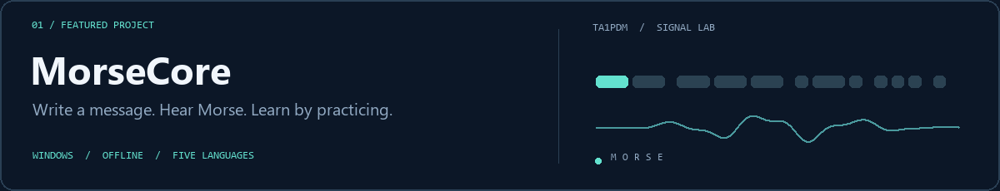

  <picture>
    <source media="(max-width: 600px)" srcset="assets/hero-mobile.svg" />
    
  </picture>

  <a href="#featured-project">Featured project</a> &nbsp; / &nbsp;
  <a href="#on-the-horizon">On the horizon</a> &nbsp; / &nbsp;
  <a href="#toolkit">Toolkit</a> &nbsp; / &nbsp;
  <a href="#connect">Connect</a>

I study **Mechanical Engineering at Istanbul Technical University** and build software alongside it. My interests span aerodynamics, aircraft systems, CAD/CAM, desktop applications and small devices.

## Featured project

Convert text to Morse, listen, practise and keep amateur radio contact logs. Includes offline speech and interfaces in **Türkçe, English, Deutsch, Русский and العربية**.

**Windows x64 · Preview** &nbsp; [Explore the project ↗](https://github.com/mustafamertakceylan/MorseCore) &nbsp; · &nbsp; [Downloads & releases](https://github.com/mustafamertakceylan/MorseCore/releases)

## On the horizon

Upcoming projects — under development, with no public release announced.

<table>
<tr>
<td width="24%" valign="top"><h3>Kovan</h3>01 / UPCOMING</td>
<td valign="top">
<strong>Embedded inference</strong>

A hive of ESP32 boards. Exploring offline language-model inference across small devices.

ESP32-S3 · C/C++ · ESP-IDF
</td>
</tr>
<tr>
<td width="24%" valign="top"><h3>Petek</h3>02 / UPCOMING</td>
<td valign="top">
<strong>Small Turkish models</strong>

A companion to Kovan. Tiny Turkish language models designed for microcontrollers.

Python · PyTorch · Tokenization
</td>
</tr>
<tr>
<td width="24%" valign="top"><h3>Hushbar</h3>03 / UPCOMING</td>
<td valign="top">
<strong>A quieter menu bar</strong>

A native macOS menu bar manager. Exploring a calmer, more focused desktop.

Swift · SwiftUI · AppKit
</td>
</tr>
</table>

## Toolkit

| Focus | Tools & technologies |
| :--- | :--- |
| Systems & desktop | **C** · **C++** · **C#** · .NET · CMake |
| Apple platforms | **Swift** · SwiftUI · AppKit |
| Embedded & models | **ESP32** · ESP-IDF · Python · PyTorch |
| Mechanical design | **AutoCAD** · **Fusion 360** · CAD/CAM |
| Everyday workflow | **Git** · GitHub |

## Beyond the screen

**TA1PDM** · Class A amateur radio operator  
Student & Amateur UAV Pilot License · Type 1A

Aircraft technologies, aerodynamic analysis and motorsports engineering keep me curious about the systems behind the software.

## Connect

[LinkedIn ↗](https://www.linkedin.com/in/mertakceylan/) &nbsp; · &nbsp; [Email ↗](mailto:mustafamertakceylan@gmail.com)

---

Engineering, code and signals.

